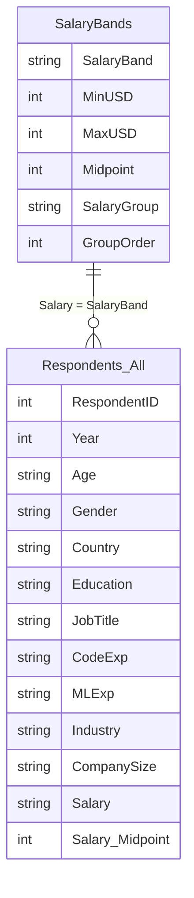
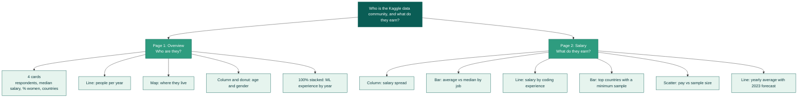

# What Does Kaggle's Data Community Look Like?
### A two-page Power BI dashboard on the Kaggle ML & Data Science Survey, 2017-2022


---

## 1. Project goal
Every year Kaggle asks its community about their jobs, skills, and pay. I combined six years of answers to see **who the data community is, how it is changing, and what its members earn.**

Questions I wanted to answer:
1. Who answers the survey, and where do they live?
2. Is the community getting bigger and more experienced?
3. What do people earn, and what is linked to higher pay?
4. Which salary numbers can we trust, and which are too small a sample?

## 2. Data
| Item | Detail |
|---|---|
| Source | Kaggle Machine Learning & Data Science Survey (2017-2021 combined file, and the 2022 file) |
| Size | About 130,000 responses, 70 countries |
| What a row is | One person's answers in one year (people are not tracked across years) |
| My own file | `salary_lookup.csv`, which turns salary ranges into numbers |
| Files | `Data/Data.zip` has the CSV files and the lookup |

Please check the licence on the Kaggle survey pages, and credit Kaggle if you reuse the data.

## 3. How I worked


## 4. Data cleaning: what I did and why
| Problem I found | What I did | Why |
|---|---|---|
| Question numbers changed in 2022 (Q5 was job title before, but not in 2022) | Matched columns by their meaning, not their number | Stops wrong columns being joined |
| 2022 file has no year column | Added `Year = 2022` | Needed for trends |
| Two files with the same kind of rows | Appended them into one table | One table for 2017-2022 |
| Broken characters (`Bachelor’s`) and curly vs straight apostrophes | Replaced them with one spelling | Same answer was counted as two |
| Same country with different names (USA, United States, ...) | Merged the names | One bar per country |
| Old and new labels (Male/Man, `< 1 year`/`Less than a year`) | Made one set of labels | Years can be compared |
| 35 job titles in old years, 15 in 2022 | Grouped into 11 job groups | Fair comparison across years |
| Experience ranges changed between years | Grouped into 5 wider bands | Same reason |
| Salary is a range like `10,000-14,999` | Built a lookup table with a midpoint, a group, and a sort order | You cannot average text |
| Groups sorted in alphabetical order | Added sort-order columns | Bars appear in a natural order |

## 5. Data model

One lookup row can match many respondents (many-to-one, filtering in one direction).

## 6. Main DAX measures
```
Total Respondents = COUNTROWS(Respondents_All)

Salary Respondents = COUNTX(Respondents_All, RELATED(SalaryBands[Midpoint]))

Avg Salary = AVERAGEX(Respondents_All, RELATED(SalaryBands[Midpoint]))

Median Salary = MEDIAN(Respondents_All[Salary Midpoint])

% Women =
DIVIDE(CALCULATE([Total Respondents], Respondents_All[Gender] = "Woman"),
       CALCULATE([Total Respondents], Respondents_All[Gender] <> BLANK()))

Country Respondents =
VAR c = SELECTEDVALUE(Respondents_All[Country])
RETURN IF(ISBLANK(c) || c IN {"Other", "Not Disclosed"}, BLANK(), [Total Respondents])

Avg Salary (Filtered) =
VAR c = SELECTEDVALUE(Respondents_All[Country])
RETURN IF(NOT ISBLANK(c) && NOT (c IN {"Other", "Not Disclosed"})
          && [Salary Respondents] >= [Min Respondents Value], [Avg Salary])
```
- **`Avg Salary (Filtered)`** hides countries with too few answers. A "minimum respondents" slider controls the cut-off.
- **Median** is shown next to the average because a few very high salaries pull the average up.

## 7. What is on the dashboard

Three slicers (Year, Country, Gender) work on both pages. A "Clear all slicers" button resets them.

## 8. Key findings
- **The community is not evenly spread.** India overtook the USA as the largest group in 2019 (about 26% vs 17% of respondents with a known country). By 2022 India was about 39%.
- **Pay rises with coding experience.** The average estimate goes from about $24K (under 1 year) to about $92K (10+ years).
- **Averages and medians are very different.** The average salary estimate is about $49K, but the median is about $22.5K. A small group of high earners pulls the average up.
- **Managers and product roles have the highest average pay** (about $79K), ahead of data scientists (about $60K).
- **Top-paying countries (with at least 50 respondents):** USA, Switzerland, Israel, and Australia, at about $100K to $120K.
- **Small samples can fool you.** One country topped the pay chart with only 13 salary answers. The minimum-sample slider removes cases like this.
- **About 18.5% of respondents who gave a gender are women.**

## 9. Limits
- Only people who chose to answer Kaggle's survey are included. This describes the Kaggle community, not all data professionals.
- No salary question in 2017, and 2018 used wider salary ranges.
- Salaries are estimates from the middle of each range, in US dollars. The top open-ended bands use their lower limit, so high earners are slightly under-counted.
- 2022 has no "Student" job title, because students were not asked.
- The forecast line uses only five yearly points, so it is a rough guide.

## 10. Skills shown
Data cleaning and combining files in Power Query, data modelling, DAX (CALCULATE, iterators, variables), choosing the right chart for each question, handling small samples, and clear writing about limits.

## Author
**Sourish Halder**, M.Sc. Applied Data Science, SRM Institute of Science and Technology
Data credit: Kaggle ML & DS Survey.
